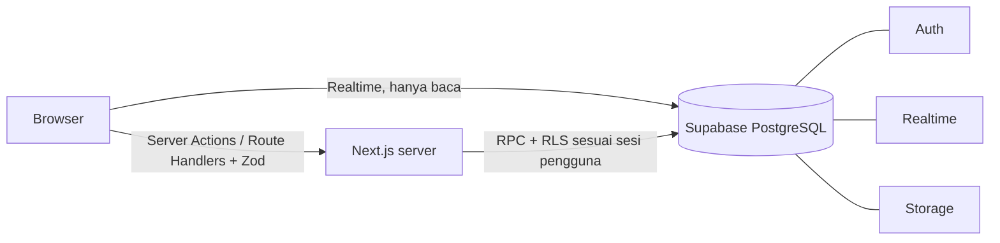
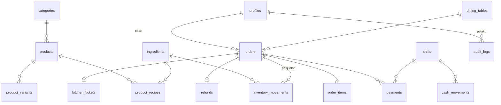
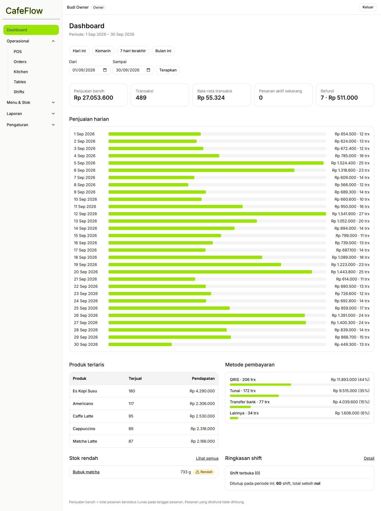
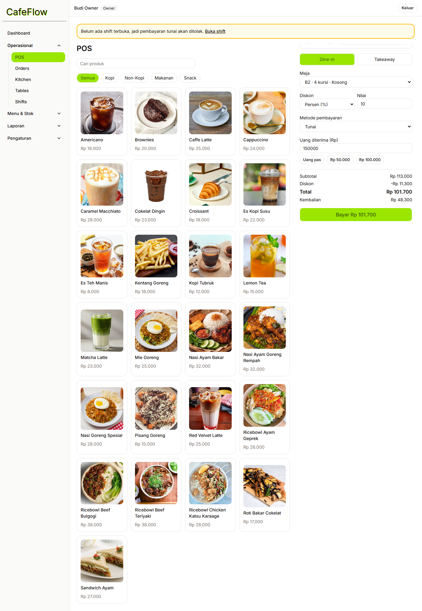
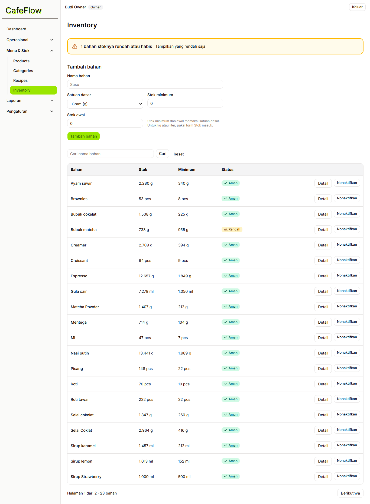
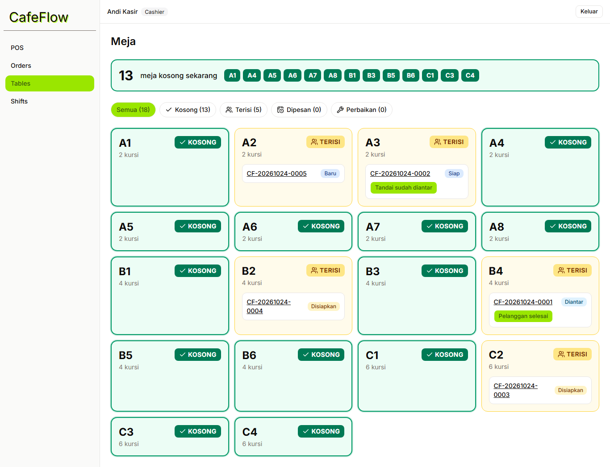
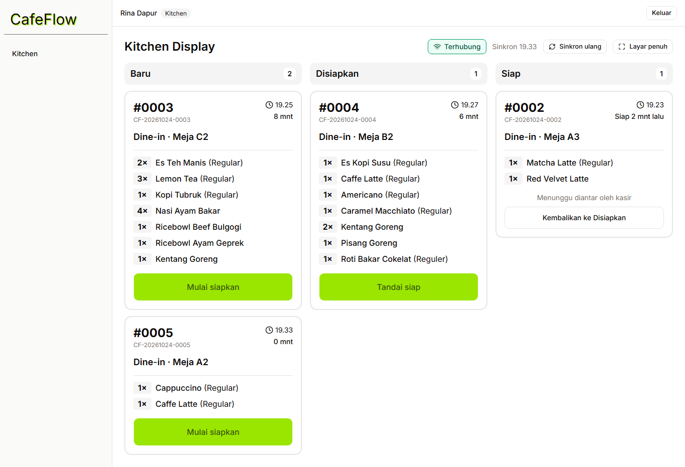
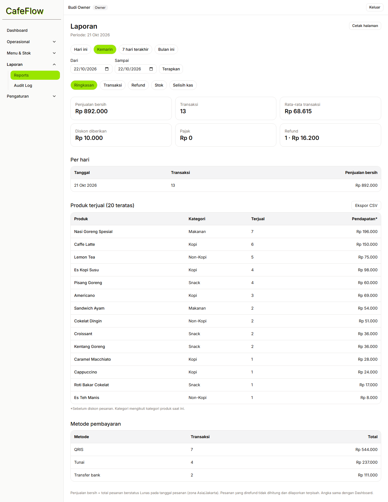

# CafeFlow POS

Aplikasi Point of Sale berbasis web untuk kafe/restoran satu cabang: kasir, dapur (KDS realtime), meja, menu, stok bahan berbasis resep, shift kasir, laporan, dan audit log, dengan hak akses berbasis role.

**Demo:** <tautan-vercel> · **Tech stack:** Next.js (App Router) · TypeScript · Tailwind CSS · shadcn/ui · Supabase (PostgreSQL, Auth, Realtime, Storage) · Vercel

## Fitur inti

- **POS**: produk, varian, catatan, dine-in/takeaway, diskon (Owner/Manager), pembayaran tunai/QRIS/transfer/lainnya, struk cetak.
- **Checkout atomik**: satu fungsi database membuat pesanan, item, pembayaran, dan mutasi stok. Harga dan total dihitung ulang di server, aman dari klik ganda (idempotency key) dan dari stok negatif.
- **KDS realtime**: kolom Baru/Disiapkan/Siap, timer tunggu, indikator koneksi, sinkron ulang otomatis.
- **Meja**: penanda meja kosong, pesanan aktif per meja, pelepasan meja saat pelanggan pergi.
- **Inventory & resep**: stok berkurang sesuai resep tepat sekali per pesanan; semua perubahan tercatat sebagai mutasi.
- **Shift kasir**: kas awal, kas masuk/keluar, selisih saat tutup; tunai wajib punya shift terbuka.
- **Laporan & dashboard**: definisi hitung yang sama, filter periode, ekspor CSV, tampilan cetak.
- **Audit log** (Owner): harga, resep, stok, role, pengaturan, refund, shift.

## Arsitektur



Pemisahan tanggung jawab: UI di Next.js, otorisasi dan operasi sensitif di server, integritas data (transaksi, constraint, RLS) di PostgreSQL.

## ERD



## Menjalankan secara lokal

Prasyarat: Node 20.6+, Docker Desktop.

```bash
npm install
cp .env.example .env.local        # isi dengan kunci project Supabase milikmu
npx supabase link --project-ref <ref>
npx supabase db push              # migration
```

Variabel lingkungan:

| Variabel                        | Keterangan                                  |
| ------------------------------- | ------------------------------------------- |
| `NEXT_PUBLIC_SUPABASE_URL`      | URL project                                 |
| `NEXT_PUBLIC_SUPABASE_ANON_KEY` | anon/publishable key                        |
| `SUPABASE_SERVICE_ROLE_KEY`     | **rahasia**, hanya server, jangan di-commit |
| `NEXT_PUBLIC_SITE_URL`          | URL aplikasi (untuk tautan reset password)  |

Data demo (jangan pada database yang berisi data asli):

```bash
npm run seed:demo
```

## Akun demo

| Role    | Email               | Akses                            |
| ------- | ------------------- | -------------------------------- |
| Owner   | owner@example.com   | semua modul                      |
| Manager | manager@example.com | operasional, menu, stok, laporan |
| Cashier | cashier@example.com | POS, pesanan, meja, shift        |
| Kitchen | kitchen@example.com | KDS                              |

Password: `Demo12345!` (ubah dengan env `DEMO_PASSWORD` saat seed).

## Screenshot

| Dashboard                           | POS                           | KDS                                 |
| ----------------------------------- | ----------------------------- | ----------------------------------- |
|  |  |  |

| Meja                             | Inventory                     | Laporan                           |
| -------------------------------- | ----------------------------- | --------------------------------- |
|  |  |  |

## Keamanan

- RLS aktif di semua tabel; browser tidak punya hak tulis langsung ke pesanan, pembayaran, stok, dan audit log.
- Semua operasi sensitif lewat fungsi database `security definer` yang memeriksa role, status, dan urutan transisi.
- Role, harga, total, dan status tidak pernah dipercaya dari browser.
- Service role key hanya di server (dijaga tes statis). Pendaftaran publik ditutup; akun baru tidak aktif sampai Owner mengaktifkan.
- Akun dinonaktifkan langsung kehilangan akses di level database, bukan hanya di UI.
- Audit log hanya dapat dibaca (Owner); tidak ada jalur ubah/hapus.
- Header keamanan HTTP, validasi Zod di server, batas ukuran upload, ekspor CSV anti formula-injection.

## Pengujian

```bash
npm test                    # unit
npx supabase start && npm run seed:local
npm run test:integration    # RLS tiap role, checkout, stok, shift, refund (Supabase lokal)
npm run test:e2e            # alur kasir → dapur → meja, responsif, aksesibilitas
```

## Keterbatasan MVP

- Satu cabang; tanpa integrasi payment gateway/EDC, printer thermal, atau aplikasi pesan-antar.
- Refund hanya penuh (tanpa refund sebagian); stok tidak dikembalikan otomatis.
- Shift yang sudah ditutup tidak dapat dikoreksi.
- Draft keranjang belum tersedia; keranjang hanya tersimpan selama halaman POS terbuka.
- Belum ada Content-Security-Policy ketat dan rate limiting selain bawaan Supabase Auth.
- Tidak ada pajak otomatis; persentase pajak diatur manual (default 0).
